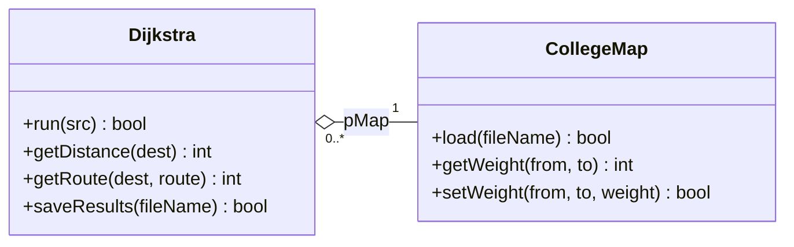

# Dijkstra Route Planner


Dijkstra shortest-route planner in C++ for my Object Programming module (ELX4) at MTU. It loads a campus map from a text file and works out the shortest distance and route from any node to every other node.

## Status

**Finished and submitted on 22 October 2026.** The report (PDF) went in on Canvas with the AI solution zip and my ported tests. The code in `MapLib`, `MapDemo` and `MapTests` is the submitted version.

## What's in here

The solution has three projects:

| Project | What it is |
| --- | --- |
| `MapLib` | Static library with the two classes, `CollegeMap` and `Dijkstra` |
| `MapDemo` | Console app that runs through the demo from the brief |
| `MapTests` | Google Test project with 20 tests |

`Report/` has the UML class diagram as a draw.io file. The written report is submitted as a PDF on Canvas.

## AI solution (Part D)

`AISolution/` is the solution an AI tool generated for Part D. It's kept separate from my code and has its own solution file, so it doesn't touch `RoutePlanner.sln`. Open `AISolution/AISolution.slnx` to build it.

| Project | What it is |
| --- | --- |
| `CollegeMapLib` | The AI's `CollegeMap` and `Dijkstra` classes |
| `Demo` | The AI's demo program |
| `Tests` | The AI's own 65 Google Test tests (all pass) |
| `PortedTests` | My 20 tests from `MapTests`, changed to fit the AI's class interface |

On the map exactly as supplied in the brief, 13 of my 20 tests pass on the AI code and 7 fail. 3 of the failures are because the AI rejects the non-symmetric `MTU Map.txt`, 3 are output layout differences and 1 is a save-file difference. The report goes through each one.

## How the classes fit together

`CollegeMap` reads the map file, checks it and keeps the weights in a 2D array allocated with `new[]`. `Dijkstra` holds a pointer to a `CollegeMap` and runs the algorithm on it. Dijkstra never deletes the map, so the map can outlive any Dijkstra object that uses it. That's the aggregation the assignment is about.



## Moving between computers

Commit and push before you leave one machine, and pull when you sit down at the next. In Visual Studio that's Git > Commit All, then Git > Push, and Git > Pull on the other side. If you forget to push, the changes stay on the first computer.

## Map file format

```
Map_Name
<number of nodes>
<n x n grid of edge weights>
```

A weight of 0 means there's no direct edge between two nodes. A small example:

```
Tiny_Map
3
0 5 0
5 0 2
0 2 0
```

The `MTU Map.txt` from the brief isn't symmetric ([3][5] is 14 but [5][3] is 0, and [6][3] is 14 but [3][6] is 0), so the loader prints a warning for it instead of rejecting the file.

Dijkstra reads row `u` of the matrix as the edges going out of node `u`, so those two edges only work in one direction. `setWeight()` always sets both directions.

## Progress

- [x] `CollegeMap`: loading, validation and storage
- [x] `CollegeMap`: copy constructor, `=`, `==` and `<<`
- [x] `Dijkstra`: algorithm, results and saving to file
- [x] Demo program
- [x] Unit tests (20)
- [x] UML class diagram
- [x] Confirm the Visual Studio build has no warnings at /W3
- [x] Report
- [x] AI comparison (Part D)
- [x] Submitted (22 October 2026)

## Rules from the brief

Each class lives in its own `.h` and `.cpp`. No inheritance. All the dynamic arrays use raw `new[]` and `delete[]`, so no `vector` or smart pointers, and every allocation gets freed exactly once.

---

Alan O'Connell, Electronic Engineering, Munster Technological University
