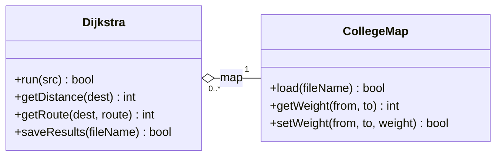

# RoutePlanner


Dijkstra shortest-route planner in C++ for my Object Programming module (ELX4) at MTU. It loads a campus map from a text file and works out the shortest distance and route from any node to every other node.

## What's in here

The solution has three projects:

| Project | What it is |
| --- | --- |
| `MapLib` | Static library with the two classes, `CollegeMap` and `Dijkstra` |
| `MapDemo` | Console app that runs through the demo from the brief |
| `MapTests` | Google Test project with 46 tests |

`Report/` has the UML class diagram as a draw.io file.

## How the classes fit together

`CollegeMap` reads the map file, checks it and keeps the weights in a 2D array allocated with `new[]`. `Dijkstra` holds a pointer to a `CollegeMap` and runs the algorithm on it. Dijkstra never deletes the map, so the map can outlive any Dijkstra object that uses it. That's the aggregation the assignment is about.



## Setting it up on a new computer

You need Windows and Visual Studio 2026 with the "Desktop development with C++" workload. The Google Test adapter comes with that workload, but check it's ticked in the Visual Studio Installer.

Clone the repo, either from a terminal:

```
git clone https://github.com/Alan64578/RoutePlanner.git
```

or in Visual Studio with File > Clone Repository and the same URL. Then:

1. Open `RoutePlanner.sln`.
2. If Visual Studio asks to retarget the projects, click OK. You'll only see this on an older version.
3. Build with Ctrl+Shift+B. NuGet downloads Google Test on the first build. If you get a missing packages error, right-click the solution and pick Restore NuGet Packages.
4. MapDemo should already be the startup project, so Ctrl+F5 runs the demo.
5. For the tests go to Test > Test Explorer > Run All.

Build output, `.vs/` and the NuGet packages are in `.gitignore`, so a fresh clone stays small and nothing machine-specific gets committed.

### Moving between computers

Commit and push before you leave one machine, and pull when you sit down at the next. In Visual Studio that's Git > Commit All, then Git > Push, and Git > Pull on the other side. If you forget to push, the changes stay on the first computer.

## Map file format

```
Map_Name
<number of nodes>
<n x n grid of edge weights>
```

A weight of 0 means there's no direct edge between two nodes. A small example:

```
Tiny_Map
3
0 5 0
5 0 2
0 2 0
```

The `MTU Map.txt` from the brief isn't symmetric ([3][5] is 14 but [5][3] is 0, and the same for [6][3]), so the loader prints a warning for it instead of rejecting the file.

## Progress

- [x] `CollegeMap`: loading, validation and storage
- [x] `CollegeMap`: copy constructor, `=`, `==`, `!=` and `<<`
- [x] `Dijkstra`: algorithm, results and saving to file
- [x] Demo program
- [x] Unit tests (46)
- [x] UML class diagram
- [ ] Confirm the Visual Studio build has no warnings at /W3
- [ ] Report
- [ ] AI comparison (Part D)

## Rules from the brief

Each class lives in its own `.h` and `.cpp`. No inheritance. All the dynamic arrays use raw `new[]` and `delete[]`, so no `vector` or smart pointers, and every allocation gets freed exactly once.

---

Alan O'Connell, Electronic Engineering, Munster Technological University
